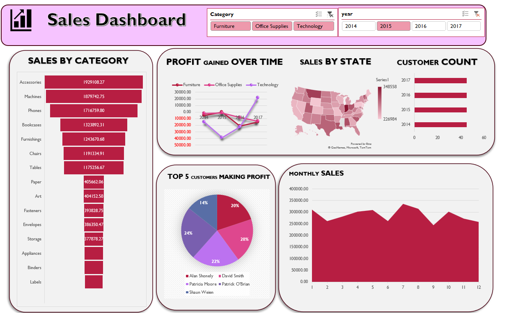
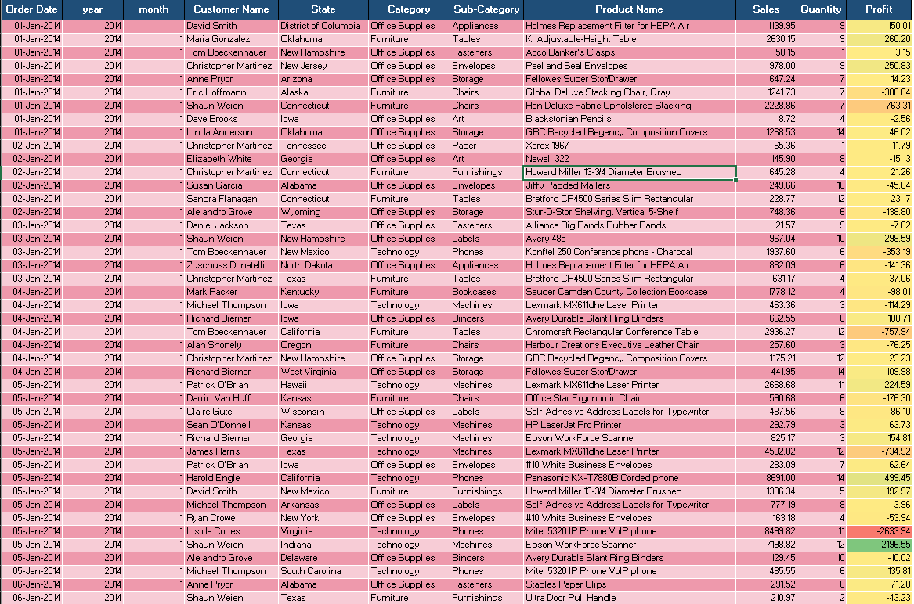
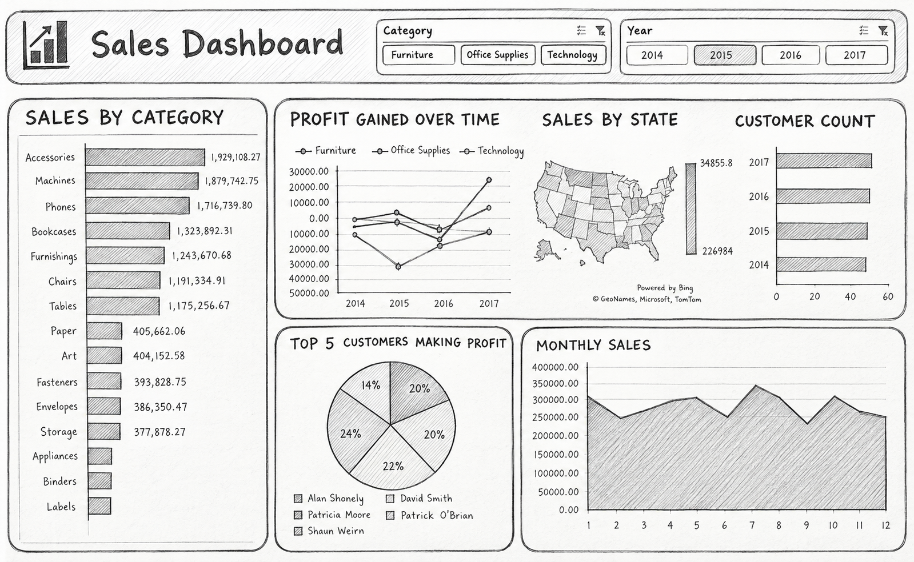

# Nexora-excel-dashboard
Interactive excel dashboard for the fictional company of Nexora
 

**This Excel sales dashboard for Nexora helps users analyze sales performance, revenue trends, and top-performing products and regions in one clear, interactive view**

## Project Preview

## Project Overview

Write two or three short sentences explaining:

- This is an interactive Excel sales dashboard built for Nexora, designed to turn raw sales data into clear visuals
- It covers sales and profit from 2014 to 2017 across product categories, US states, customers, and months.
- Users can filter by category and year to see top-selling products, profit trends, regional performance, and which customers contribute the most profit.

## From Data to Dashboard

I’ve finished inspecting your workbook’s structure, so here’s the short version of how it was built.

How the project was created

- Raw data: About 10,000 rows of order records (order date, customer, state, category, sub-category, product, sales, quantity, profit) were loaded into the “Sales Data” sheet and formatted as an Excel Table. Year and month columns were added so the data could be grouped by time.
- Pivot tables: Several pivot tables summarize the data, for example sales by sub-category, profit by category and year, and sales by month. A second small table (year and customer name) feeds the customer count.
- Charts: Each pivot table drives a chart. These include a bar chart for sales by category, a line chart for profit over time, an area chart for monthly sales, a pie chart for the top 5 customers by profit, and a map for sales by state.
- Slicers: Category and Year slicers are connected to the pivot tables, so clicking a filter updates the charts together.
- Dashboard sheet: All the charts and slicers were arranged on one “Dashboard” sheet, following your sketch’s layout.

### Source Data

### Dashboard Sketch

> This section is optional. Remove any images or subsections that are not relevant to your project.

## Dashboard Features

- Interactive filters: Category (Furniture, Office Supplies, Technology) and Year (2014-2017) slicers update every chart at once.
- Sales by category: A ranked chart of sub-categories, from Accessories and Machines at the top down to Labels and Binders.
- Profit over time: A line chart comparing profit across the three categories from 2014 to 2017.
- Sales by state: A US map that shades states by sales volume.
- Customer count: A yearly view of how many customers ordered.
- Top 5 customers by profit: A pie chart showing each customer’s share of profit.
- Monthly sales: An area chart showing seasonality and peak months across the year.
- Pivot-based design: All charts are built on pivot tables over a single data table, so the dashboard can be refreshed when the data changes.
- One-page layout: Everything sits on a single Dashboard sheet, so users get the full picture without switching tabs.
## Files Included

| File | Description |
|---|---|
| `NEXORA SALES DASHBOARD.xlsx` | Completed Excel dashboard |
| `Dashboard-image.png.png` | Preview of the final dashboard |
| `Dashboard-sketch.png.png` | Initial dashboard layout |
| `data.png.png` | Preview of the source data |
| `README.md` | Project documentation |

## How to Download and Use

1. Download `NEXORA SALES DASHBOARD.xlsx`.
2. Open the workbook using Microsoft Excel.
3. Navigate to the dashboard worksheet.
4. Use the available filters and slicers to explore the results.

[Download the Excel Dashboard](NEXORA SALES DASHBOARD.xlsx)

## Tools and Skills

- Microsoft Excel
- Excel formulas
- PivotTables
- PivotCharts
- Slicers
- Data analysis
- Dashboard design
- Data visualization

